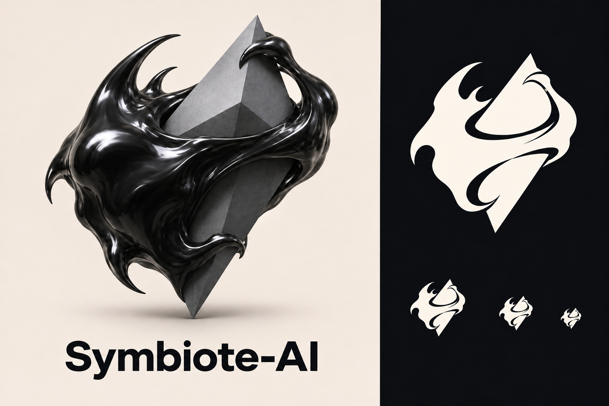

# Symbiote-AI

> **Language:** [Português (Brasil)](README.md) *(canonical)* · **English** — see [`i18n/`](i18n/README.md) to contribute additional languages.



Symbiote-AI integrates into new or existing projects and amplifies what your team already does with AI-assisted development. The kit provides portable procedures to start work, gather requirements, write specifications, review code, sync time entries, and track tasks on your board. It works natively with **Claude Code**, **Antigravity**, **Gemini CLI**, **Codex**, **Cursor**, and **VSCode + Copilot**.

> Extracted and generalized from a real product team's workflow. The core is **stack-neutral**, project-specific values use **placeholders** (`<...>`), technology specializations live as **optional adapters** under [`adapters/`](i18n/en/adapters.md), and **`pt-BR`** is kept as the single canonical language in `processes/` while `simbiose` configures your project's target language (`en`, `pt-BR`, `es`, etc.) for UI, docs, and commits.

## Philosophy (why this is portable)

- **Tool-neutral canonical procedures** in [`processes/`](processes/) — the single source of truth, independent of any AI tool (authored in `pt-BR` to prevent cross-language drift; AI agents read them directly and deliver in your project's configured language).
- **Thin per-tool wrappers** that only point to the canonicals:
  - Antigravity / Gemini CLI / Codex → `.agents/skills/<name>/SKILL.md` + `AGENTS.md` / `GEMINI.md`
  - Claude Code → `.claude/skills/<name>/SKILL.md`
  - Cursor → `.cursor/rules/<name>.mdc`
  - VSCode + Copilot → `.github/copilot-instructions.md`
- **`ai-tools-matrix.md`** maps MCP tool-call names across AI tools.
- The [integration matrix](docs/integracoes.md) documents how to combine board, repository, and other service providers and which operations have been verified.
- **Optional adapters** in [`adapters/`](i18n/en/adapters.md) isolate stack (`angular`, `react`), cloud (`cloudflare`, `aws`), and observability (`opentelemetry`) specializations outside the neutral core, selectively coupled by the `simbiose` skill.
- **Placeholders** (`<AZURE_ORG>`, `<PROJECT_KEY>`, `<TEST_CMD>`, …) mark everything specific to a project. The `simbiose` skill fills them in.

When switching AI tools or trackers, update the wrappers and project configuration according to the chosen integration.

## Getting started

### Contribute a small change

Open a checkout of Symbiote-AI and ask your AI tool: `"Use start-workflow in the Express Flow to fix [issue]"`. Then review the diff and run [local validation](#local-validation). The local workflow uses Git, Python 3, and Bash and can be completed without configuring project credentials, MCP integrations, or `.env` files.

### Apply the kit to a project

With the kit available in your AI tool, invoke the **`simbiose`** skill (e.g. **`$simbiose`** in Codex, **`/simbiose`** in Claude Code, or ask *"Use the simbiose skill"* in Antigravity and Gemini CLI — in Gemini CLI, run `/skills list` to verify discovery). If you are working in another directory, pass the target path. The skill detects an existing project and proposes an adaptation plan (including compatible adapters under `adapters/` and the project's target language for UI, docs, and commits), or prepares a new project setup. When the context is ambiguous, it asks before starting.

To expose the skills directly inside an existing repository, copy the kit contents into that repository's root while preserving existing configuration files.

Configure integrations as you need them. For integrations that use `.env` files, start from the `.env.example` files and keep secrets out of Git. Use the corresponding setup skill, such as `setup-azure-mcp`, `setup-jira`, `setup-7pace`, or `setup-sonarqube-mcp`. To install system tools and plugins, run `full-setup` when needed.

Start working with `start-workflow` and use the Express Flow for small changes.

## Skills

| Skill | What it does |
|---|---|
| `simbiose` | Applies the kit to an existing project or creates a new already-integrated project |
| `start-workflow` | Session entry point: Feature, Bug, Follow-up, Refactor, Tests, **Express**, Freestyle |
| `figma-requirements` | Gathers feature requirements from a **Figma** design (local or hosted MCP) |
| `spec-builder` | Builds a feature specification from the standard template |
| `create-work-item` | Creates or links a work item on the project's configured board |
| `phase-code-review` | Risk-proportional code review with static analysis and tests, applying fixes only when authorized |
| `timesync` | Logs hours to one or more time-tracking tools configured for the project |
| `docs-target` | Configures whether process docs live in-repo or in an external platform (Confluence/Outline/Notion) |
| `setup-azure-mcp` / `setup-jira` | Configures the tracker MCP (Azure DevOps or Jira/Atlassian) |
| `setup-sonarqube-mcp` | Configures the SonarQube MCP (via Docker) |
| `setup-7pace` | Configures 7pace Timetracker integration |
| `full-setup` | Full environment setup on a new machine |

## Layout

```
Symbiote-AI/
├── README.md                     ← canonical README (pt-BR)
├── README.en.md                  ← this file (English README)
├── CHANGELOG.md                  ← release history
├── LICENSE                       ← Apache License 2.0 text
├── NOTICE                        ← copyright and license notice
├── .gitignore                    ← keeps .env out of Git (preserves .env.example)
├── GUIA-DE-EXPANSAO.md           ← how to swap tools and add skills, adapters, or languages (pt-BR)
├── ai-tools-matrix.md            ← MCP tool-call mapping across AI tools
├── AGENTS.md                     ← catalog and instructions for Codex / Antigravity / Gemini CLI
├── GEMINI.md                     ← lean entry point for Gemini CLI / Antigravity
├── .agents/
│   └── skills/<skill>/SKILL.md   ← open Agent Skills standard (Antigravity, Gemini CLI, Codex)
├── .github/
│   ├── copilot-instructions.md   ← VSCode + Copilot wrapper
│   └── workflows/ci.yml          ← automated validation on Linux and macOS
├── .claude/                      ← Claude Code: skills, integrations, settings
│   ├── PROJECT_REFERENCE.md      ← project reference (template to fill in)
│   ├── settings.json             ← permissions
│   ├── skills/<skill>/SKILL.md
│   └── integrations/
│       ├── timetracking/         ← 7pace+Clockify wrapper (with .env.example, no .env)
│       └── clockify-mcp/         ← (optional, not bundled) created by cloning the Clockify MCP
├── .cursor/
│   ├── settings.json             ← minimal editor defaults (formatting/linting stay project-owned)
│   └── rules/<skill>.mdc         ← Cursor wrappers (+ PROJECT-REFERENCE-md.mdc)
├── processes/                    ← CANONICAL PROCESSES (single source of truth, pt-BR)
├── adapters/                     ← optional adapters (stacks/angular, stacks/react, cloud/cloudflare, cloud/aws, observability/opentelemetry)
├── i18n/                         ← multilingual manifest (i18n.json) and translated guides (e.g. en/)
├── templates/                    ← spec-template, story.template, project-reference (template)
├── docs/                         ← workflow, discovery (template), e2e, integracoes, work-items process, lessons learned
├── scripts/                      ← validator (`validate-kit.py`) and timesync (`time-entry-interval.py`, `sync-7pace.sh`, `setup-7pace.*`)
└── tests/                        ← automated tests for the validator, adapters, i18n, and timesync scripts
```

## Tools and integrations

- **AI tools:** native support for **Claude Code**, **Antigravity**, **Gemini CLI**, **Codex**, **Cursor**, and **VSCode + Copilot** (via wrappers + `ai-tools-matrix.md`). Additional tools follow Recipe E in [`i18n/en/expansion-guide.md`](i18n/en/expansion-guide.md).
- **Tracker / Board:** Azure DevOps, Jira/Atlassian (`setup-jira`), or any board configured in `.claude/PROJECT_REFERENCE.md` (see [`docs/integracoes.md`](docs/integracoes.md); teams without a board can run locally with the journal).
- **Quality:** local static analysis such as [SonarJS via ESLint](https://github.com/SonarSource/SonarJS/blob/master/packages/analysis/src/jsts/rules/README.md) for JS/TS, plus SonarQube via MCP when already configured.
- **Time tracking:** 7pace and Clockify (explicit-offset ISO 8601 timestamps normalized to UTC), extensible to **Toggl/Harvest** per [`i18n/en/expansion-guide.md`](i18n/en/expansion-guide.md).
- **Documentation:** in-repo **or** external (Confluence/Outline/Notion) via `docs-target` — keeping PRs clean.
- **Design:** Figma via MCP (local Dev Mode or hosted) in `figma-requirements`.
- **Browser/visual:** Playwright MCP (visual validation and E2E).
- **Superpowers** (https://github.com/obra/superpowers): cross-platform process skill pack (brainstorming, TDD, debugging, code review) referenced by the canonicals.

## Local validation

To validate wrapper parity, internal links, shell scripts, adapters, `i18n/` H2 counts and reciprocal README links, and unit tests:

```bash
python3 -B scripts/validate-kit.py
python3 -B -m unittest discover -s tests -v
```

## Security

- **No secrets** ship in the kit. Tokens come from environment variables / secret managers; `.env` files stay out of Git — use `.env.example`.
- The kit does not bundle a secrets hook. To block reading files with detected secrets, install the SonarSource CLI hook in your project (see *Optional third-party components*).
- Time-tracking scripts read tokens from environment variables (preferring Keychain/1Password/Bitwarden — see `setup-7pace`).

## Principles

The kit encodes lessons from high-velocity AI-assisted engineering — see [`docs/aprendizados.md`](docs/aprendizados.md) and the *Princípios* section in [`processes/start-workflow.md`](processes/start-workflow.md). Summary: edit docs through the orchestrator; configurable effort (`low`/`medium`/`high`/`max`) and model pairing by complexity; risk-proportional review with authorized fixes only; isolate concurrent executions/reviews touching the same files; run fast checks before long suites; match workflow weight to risk and scope; keep board tracking and journals proportional to the delivery.

## Expanding

To switch Azure DevOps to Jira, 7pace to Toggl, repo docs to Confluence, add a new AI tool, author an adapter (stack/cloud/observability), or contribute a new language: see [`i18n/en/expansion-guide.md`](i18n/en/expansion-guide.md), [`i18n/en/adapters.md`](i18n/en/adapters.md), and [`i18n/README.md`](i18n/README.md). The `simbiose` skill automates most of these choices.

## Related methodologies (prior art)

This kit is a lightweight, tool-neutral synthesis inspired by — and composable with — larger methods:

- **[Superpowers](https://github.com/obra/superpowers)** — cross-platform process skill pack (brainstorming, TDD, debugging, planning, code review). Canonical procedures invoke `superpowers:*` directly.
- **[BMAD-METHOD](https://github.com/bmad-code-org/BMAD-METHOD)** (MIT) — agentic agile dev framework with *scale-adaptive* planning and specialized agents. This kit incorporates its pillars: complexity-based flow sizing (Express vs. Full + effort/model routing) and **context-embedded tasks** ([`templates/story.template.md`](templates/story.template.md), inspired by BMAD's *story-file*). Useful pairing: do heavy planning in BMAD web bundles and feed the resulting artifacts into `spec-builder`.
- **Spec-workflow (kfc)**: document-driven spec workflow (requirements, design, tasks) using subagents from the Kiro for Claude Code extension. Not bundled; see *Optional third-party components*.

> The kit brings together Markdown procedures, optional adapters, and scripts tailored via `simbiose`. See also [`CHANGELOG.md`](CHANGELOG.md).

## Optional third-party components (not included)

These components are not bundled because they carry separate licenses. Install them independently if you want to use them:

- **Kiro for Claude Code** (https://github.com/notdp/kiro-for-cc), AGPL-3.0 license: provides the "kfc" spec agents and document-driven spec workflow.
- **SonarSource CLI secrets hook** (https://github.com/SonarSource/sonarqube-cli), LGPL-3.0 license: blocks reading files with detected secrets. To enable it, run the `sonar` CLI integration command in your project (see its repository documentation).

## License

Apache License 2.0. See [`LICENSE`](LICENSE) and [`NOTICE`](NOTICE).
