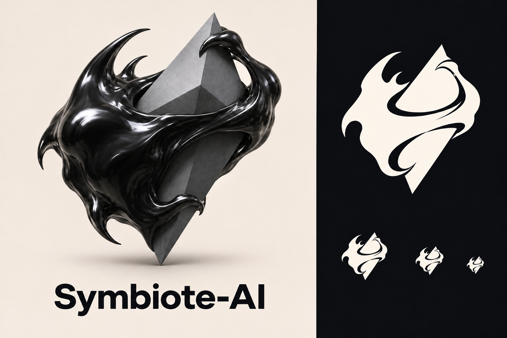

# Symbiote-AI



O Symbiote-AI se integra a projetos novos ou existentes e amplia o que a equipe já faz com desenvolvimento assistido por IA. O kit oferece processos portáteis para iniciar trabalho, levantar requisitos, escrever especificações, revisar código, sincronizar horas e acompanhar tarefas no board. Funciona com Claude Code, Cursor, Codex e Copilot.

> Extraído e generalizado de um workflow real de um time de produto. Todos os dados específicos de empresa/projeto foram trocados por **placeholders** (`<...>`) e por um stack de **exemplo** — use `/integrar` (projeto existente) ou `/simbiose` (projeto novo; alias retrocompatível: `/scaffold`) para especializá-lo ao seu contexto.

## Filosofia (por que isto é portátil)

- **Processos canônicos tool-neutral** em [`processes/`](processes/) — a fonte de verdade, independente de ferramenta.
- **Wrappers finos por ferramenta** que só apontam para os canônicos:
  - Claude Code → `.claude/skills/<name>/SKILL.md`
  - Cursor → `.cursor/rules/<name>.mdc`
  - Codex / Antigravity → `AGENTS.md`
  - VSCode + Copilot → `.github/copilot-instructions.md`
- **`ai-tools-matrix.md`** mapeia os nomes de tool-call de MCP entre as ferramentas.
- **Placeholders** (`<AZURE_ORG>`, `<PROJECT_KEY>`, `<TEST_CMD>`, …) marcam tudo que é específico de projeto. O `integrar` os preenche.

Trocar de ferramenta ou de tracker = editar wrappers/matrix, sem tocar nos processos.

## Começando

**Projeto novo (greenfield):** rode a skill **`/simbiose`** (alias retrocompatível: `/scaffold`) — escolhe o stack, gera o esqueleto com o scaffolder do ecossistema, instala o kit e já especializa.

**Projeto existente:** copie o conteúdo do kit para a raiz do repo e rode a skill **`/integrar`** — ele detecta stack, gerenciador de pacotes, framework de teste, tracker, time tracking, plataforma de docs e convenções, propõe um plano e adapta tudo (com sua confirmação).

**Depois, em qualquer caso:**
1. Preencha os `.env` a partir dos `.env.example` (no kit: `.claude/integrations/timetracking/.env.example`, usado pelo Clockify) (NUNCA versione segredos).
2. Configure as integrações que o projeto usa, como `/setup-azure-mcp` ou `/setup-jira` para o tracker e `/setup-7pace` para registrar horas. Use `/setup-sonarqube-mcp` se o projeto já tiver uma instância SonarQube.
3. (Opcional) Rode `/full-setup` para instalar ferramentas de sistema e plugins.
4. Comece a trabalhar com `/start-workflow` (use o **Fluxo Express** para mudanças pequenas).

## Skills

| Skill | O que faz |
|---|---|
| `simbiose` *(alias: `scaffold`)* | Bootstrap de projeto **novo** (greenfield) já com o kit |
| `integrar` | Adapta o kit a um projeto **existente** (stack, tracker, time tracking, docs, convenções) |
| `start-workflow` | Ponto de entrada de uma sessão: Feature, Bug, Follow-up, Refatoração, Testes, **Express**, Freestyle |
| `figma-requirements` | Levanta requisitos a partir de um design no **Figma** (MCP local ou online) |
| `spec-builder` | Constrói a especificação de uma feature a partir do template |
| `create-work-item` | Cria/vincula work item no tracker (Azure DevOps / Jira) |
| `phase-code-review` | Code review por subagente com verificação da especificação, análise estática, testes e correções |
| `timesync` | Registra horas em uma ou mais ferramentas de controle de tempo configuradas no projeto |
| `docs-target` | Define se a doc vai pro repo ou pra plataforma externa (Confluence/Outline/Notion) |
| `setup-azure-mcp` / `setup-jira` | Configura o MCP do tracker (Azure DevOps ou Jira/Atlassian) |
| `setup-sonarqube-mcp` | Configura o MCP do SonarQube (via Docker) |
| `setup-7pace` | Configura a integração com 7pace |
| `full-setup` | Setup completo do ambiente numa máquina nova |

## Layout

```
Symbiote-AI/
├── README.md                     ← este arquivo
├── LICENSE                       ← texto da Apache License 2.0
├── NOTICE                        ← aviso de copyright e licença
├── .gitignore                    ← deixa os .env fora do git (mantém os .env.example)
├── GUIA-DE-EXPANSAO.md           ← como trocar de ferramenta (Jira, Toggl, Confluence, nova IA…)
├── ai-tools-matrix.md            ← mapeamento de tool-calls por ferramenta de IA
├── AGENTS.md                     ← wrapper Codex/Antigravity (lista os processos)
├── .github/copilot-instructions.md  ← wrapper VSCode + Copilot
├── .claude/                      ← Claude Code: skills, integrações, settings
│   ├── PROJECT_REFERENCE.md      ← referência do projeto (modelo a preencher)
│   ├── settings.json             ← permissões
│   ├── skills/<skill>/SKILL.md
│   └── integrations/
│       ├── timetracking/         ← wrapper 7pace+Clockify (com .env.example, sem .env)
│       └── clockify-mcp/         ← (opcional, não vem no kit) criada pelo git clone do MCP do Clockify
├── .cursor/
│   ├── settings.json             ← troque vitest.rootConfig por <APP_DIR>/vitest.config.ts
│   └── rules/<skill>.mdc         ← wrappers Cursor (+ PROJECT-REFERENCE-md.mdc)
├── processes/                    ← PROCESSOS CANÔNICOS (fonte de verdade)
├── templates/                    ← spec-template, story.template, project-reference (template)
├── docs/                         ← workflow, discovery (modelo a preencher), e2e, processo-work-items, aprendizados
└── scripts/                      ← timesync (sync-7pace.sh, setup-7pace.*)
```

## Ferramentas e integrações

- **Ferramentas de IA:** Claude Code, Cursor, Codex/Antigravity, VSCode + Copilot (via wrappers + `ai-tools-matrix.md`). Outras, como o Gemini CLI, entram pela Receita E do `GUIA-DE-EXPANSAO.md`.
- **Tracker:** Azure DevOps **ou** Jira/Atlassian (`setup-jira`).
- **Qualidade:** análise estática local, como [SonarJS via ESLint](https://github.com/SonarSource/SonarJS/blob/master/packages/analysis/src/jsts/rules/README.md) em JS/TS, com SonarQube via MCP quando já configurado.
- **Time tracking:** 7pace, Clockify, e adaptável a **Toggl/Harvest** via `integrar`.
- **Documentação:** no repo **ou** externa (Confluence/Outline/Notion) via `docs-target` — para PRs limpos.
- **Design:** Figma via MCP (local Dev Mode ou hospedado) na `figma-requirements`.
- **Browser/visual:** Playwright MCP (validação visual e E2E).
- **Superpowers** (https://github.com/obra/superpowers): pacote multi-plataforma de skills de processo (brainstorming, TDD, debugging, code review) usado pelos canônicos.

## Segurança

- **Nenhum segredo** vai no kit. Tokens vêm de variáveis de ambiente / secret managers; os `.env` ficam fora do pacote — use os `.env.example`.
- O kit não traz hook de segredos. Se quiser bloquear a leitura de arquivos com segredos detectados, instale o hook do CLI da SonarSource no seu projeto (ver *Componentes opcionais de terceiros*).
- Os scripts de timesync leem o token de env vars (preferindo Keychain/1Password/Bitwarden — ver `setup-7pace`).

## Princípios

O kit embute lições de desenvolvimento assistido por IA "agressivo" — ver [`docs/aprendizados.md`](docs/aprendizados.md) e a seção *Princípios* em [`processes/start-workflow.md`](processes/start-workflow.md). Resumo: editar docs via orquestrador; review por subagente dedicado que corrige; nunca rodar testes/reviewer concorrentes nos mesmos arquivos; lint+typecheck antes de testes; porte do fluxo conforme o tamanho da demanda; tracker e diário proativos.

## Expandindo

Para trocar Azure DevOps por Jira, 7pace por Toggl, repo por Confluence, ou adicionar uma nova ferramenta de IA: ver [`GUIA-DE-EXPANSAO.md`](GUIA-DE-EXPANSAO.md). Na prática, o `/integrar` automatiza a maior parte.

## Metodologias relacionadas (prior art)

Este kit é uma síntese leve e neutra de ferramenta. Ele se inspira em — e combina bem com — métodos maiores:

- **[Superpowers](https://github.com/obra/superpowers)** — pacote multi-plataforma de skills de processo (brainstorming, TDD, debugging, planning, code review). Os processos canônicos invocam `superpowers:*` diretamente.
- **[BMAD-METHOD](https://github.com/bmad-code-org/BMAD-METHOD)** (MIT) — framework agêntico de dev ágil com planejamento *scale-adaptive* e agentes especializados. O kit já incorpora seus pilares: porte de fluxo por complexidade (Express vs Completo + roteamento de modelo) e **task com contexto embutido** ([`templates/story.template.md`](templates/story.template.md), inspirado no *story-file* do BMAD). Combinação útil: faça o planejamento pesado nas *web bundles* do BMAD (Gemini/ChatGPT) e traga os artefatos para o `spec-builder`.
- **Spec-workflow (kfc)**: fluxo de spec orientado a documentos (requirements, design, tasks), com subagentes da extensão Kiro for Claude Code. Não vem no kit; ver *Componentes opcionais de terceiros*.

> O kit é deliberadamente mais enxuto que o BMAD (sem instalador/runtime próprio): tudo são arquivos markdown + scripts, adaptáveis via `/integrar`. Use o BMAD completo quando quiser o ecossistema inteiro; use este kit quando quiser algo portátil e editável que você controla 100%.

## Componentes opcionais de terceiros (não incluídos)

Estes componentes não vêm no kit, porque têm licença própria. Instale à parte se quiser usá-los:

- **Kiro for Claude Code** (https://github.com/notdp/kiro-for-cc), licença AGPL-3.0: traz os agentes de spec "kfc" e o fluxo de spec orientado a documentos.
- **Hook de segredos do CLI da SonarSource** (https://github.com/SonarSource/sonarqube-cli), licença LGPL-3.0: bloqueia a leitura de arquivos com segredos detectados. Para ter o hook, rode no seu projeto o comando de integração do CLI `sonar` (ver a documentação do repositório).

## Licença

Apache License 2.0. Ver [`LICENSE`](LICENSE) e [`NOTICE`](NOTICE).

